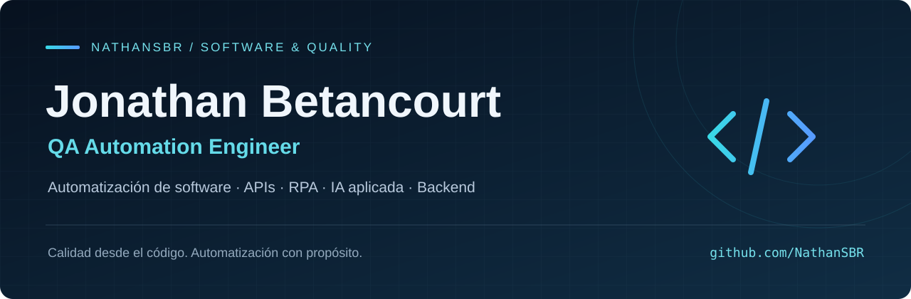
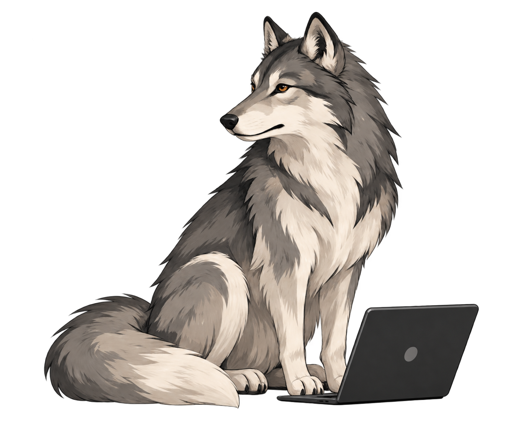

  

  
  
  

## 👋 ¡Hola! Soy Jonathan

**Software Automation Engineer · QA Automation · RPA · AI Engineer · Backend**

Soy **Jonathan Stevens Betancourt Romero**, Ingeniero Informático de la Universidad Militar Nueva Granada. Integro automatización de software, calidad, datos e inteligencia artificial aplicada para construir soluciones confiables.

- 🧪 **QA y APIs:** pruebas E2E con Playwright y Serenity BDD, validación de APIs con Postman y SoapUI.
- ⚙️ **RPA:** estrategias de prueba y certificación de procesos automatizados.
- 🐍 **Backend y datos:** Python, Node.js, SQL y Power BI.
- 🤖 **IA aplicada:** prompt engineering e integración de modelos de lenguaje.
- 💼 **Actualmente:** Programador Staff en Inetum, vinculado como Ingeniero de Datos (Python); en formación de desarrollo seguro y ADA durante el onboarding.
- 🌎 Bogotá, Colombia · Español nativo · Inglés B2 · Alemán A1.

 

## 🎯 Experiencia e impacto

| Experiencia | Aporte |
| :--- | :--- |
| **Inetum · Programador Staff** Ago. 2026 – actualidad | Vinculación como Ingeniero de Datos (Python) y formación de incorporación al proyecto. |
| **SQA · Analista de Automatización QA** Oct. 2025 – abr. 2026 | Más de **50 flujos E2E** automatizados; reducción de hasta **30 %** del tiempo de regresión por sprint; aprobación cercana al **90 %** en ciclos de certificación RPA. |
| **Seguros del Estado · Analista de Datos, práctica profesional** Feb. 2025 – ago. 2025 | Actualización de dashboards cada **30 minutos** y reducción de más del **70 %** del tiempo de generación de informes con Excel y SQL. |
| **SportMaps.co · QA & Full Stack Developer Junior, freelance** Ene. 2024 – nov. 2024 | Interfaces con Angular y React, integración de APIs REST y validación E2E de flujos críticos de pago y asistencia. |

## 🎓 Formación

**Ingeniería Informática · Universidad Militar Nueva Granada**  
Enero de 2022 – junio de 2026 · Promedio: **4.2/5.0**.

Formación complementaria en API Testing con Postman, QA y automatización de pruebas, Google Cloud Compute, prompt engineering, Claude Code, ciencia de datos y desarrollo Full Stack.

## 🛠️ Lenguajes y herramientas

  

  
  
  
  
  
  

## 🚀 Proyectos destacados

| Proyecto | Qué encontrarás | Tecnologías |
| :--- | :--- | :--- |
| **[QA Report Automation](https://github.com/NathanSBR/qa-report-automation)** | Resultados CSV convertidos en métricas verificadas, dashboards e informes editables en Word. [Ver demo](https://qa-report-automation.vercel.app). | Next.js · TypeScript · Playwright · Vitest |
| **[Reto SQA — Serenity](https://github.com/NathanSBR/reto-sqa-serenity)** | Pruebas E2E del flujo de compra en SauceDemo: login, carrito, checkout y confirmación. | Java · Serenity BDD · Cucumber · Selenium |
| **[Datepicker — Screenplay](https://github.com/NathanSBR/reto-fecha-datepicker-jsbr)** | Automatización del escenario de selección de fecha HU-001. | Java · Serenity · Screenplay |
| **[Portafolio profesional](https://github.com/NathanSBR/Portfolio_JonathanBetancourt)** | Mi experiencia, especialidades y proyectos de automatización de software. | Next.js · TypeScript · Tailwind CSS |

## 📊 Actividad en GitHub

  
  

<a href="https://github.com/NathanSBR#year-list-container">Ver el calendario completo de contribuciones en GitHub</a>

Las tarjetas se actualizan mediante servicios externos. También puedes consultar mi actividad directamente en <a href="https://github.com/NathanSBR">GitHub</a>.

## 🤝 Conectemos

Conversemos sobre **automatización de software, QA, RPA, pruebas de APIs, IA aplicada y desarrollo backend**.

🌐 **Portafolio:** [portfolio-jonathan-betancourt.vercel.app](https://portfolio-jonathan-betancourt.vercel.app)

- **LinkedIn:** [Jonathan Betancourt](https://www.linkedin.com/in/jonathansbromero/)
- **Email:** [jonathansbromero@gmail.com](mailto:jonathansbromero@gmail.com)

<strong>Calidad desde el código. Automatización con propósito.</strong>

